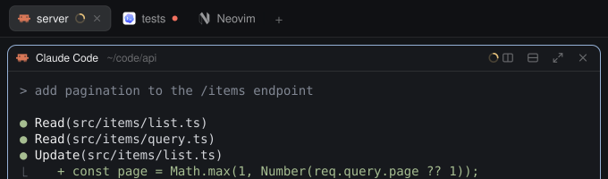
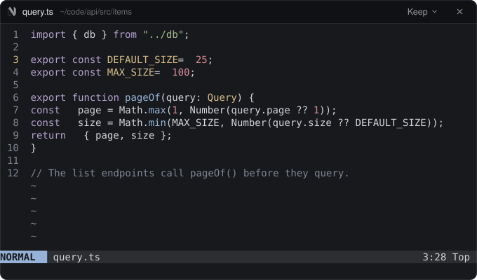
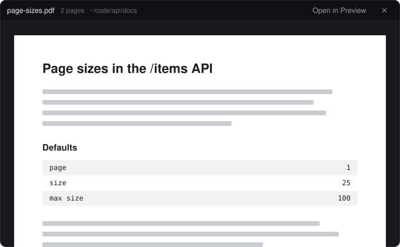
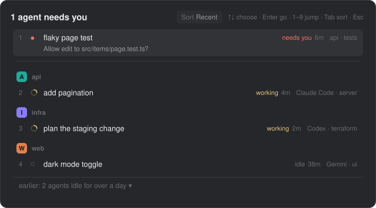

# Portrait layout for Herdr

<a href="https://miguelalexanderdiaz.github.io/herdr-portrait-layout/"></a>

A [Herdr](https://herdr.dev) layout for tall, vertical monitors. Your spaces sit side by side as columns in a strip at the top, each a tree of its tabs and panes with the state of every agent. The work area gets the rest of the screen, and a side panel brings Files and Changes when you want them.


*A drawing made from the layout's own parts and icons, with made-up content; not a screenshot of anyone's setup. Every picture is redrawn by `node scripts/make-preview.mjs`.*

Docs for humans: the [documentation site](https://miguelalexanderdiaz.github.io/herdr-portrait-layout/) (GitHub Pages from `docs/`; the address is live once the repository is public and Pages is on; until then open `docs/index.html` from a clone). Docs for agents: [AGENTS.md](AGENTS.md) and [llms.txt](llms.txt). Herdr's build brief: [RECIPE.md](RECIPE.md).

## What you get

| Part | What it is |
|---|---|
| Layouts `portrait`, `portrait-bottom` | Bar (strip plus space tree) on top, then tab bar, work area, status line. The second puts the bar between the work area and the status line. A side panel on the right is hidden until opened.<br> |
| `portrait-tree` | One column per space: tabs, panes, every agent with its state and time in it (an agent without a pane gets a row under its tab). Spaces fold into thin strips and open by themselves when an agent in them gets focus.<br> |
| `bar-strip` | Search, Add machine, Settings; a bell that says who needs you; Files, Changes and (optional) Vault buttons.<br> |
| `portrait-tabs`, `portrait-pane` | Tab bar and pane header, cloned from Herdr's shipped mods. They remember the side panel per space.<br> |
| `portrait-files`, `nvim-float`, `portrait-viewer` | Files for the focused pane's folder with git marks. Text opens in the editor you pick with the header's ▾ (nvim or another terminal editor in a floating window, VS Code, Zed, Sublime Text, the default app, or a read-only preview); pictures and PDFs open in a viewer window; other documents in the system's app. Right-click a file for *Open with*.<br><br><br> |
| `attention-picker` | The *Agents waiting* list (bundled copy of the herdr-agents-waiting mod).<br> |
| Vault panel (optional) | Works without the Obsidian mods. To add it, install `vault` and `vault-reader` from herdr-obsidian-vault and paste `snippets/vault-panel.json` into the `children` of the `panel-body` stack in each layout you use. The Vault button, tab and note rows appear only when the mod and the panel are both there. |

## Requirements

The Herdr desktop app, 0.1.12 or newer (built and used on 0.1.12). `git` (change marks), an editor such as `nvim` and Poppler (every page of a PDF; `brew install poppler`) are optional. No network, no account.

| Feature | macOS | Linux | Windows |
|---|---|---|---|
| Layouts, tree, tab bar, pane headers, bell, waiting list | Works | Not run, expected to work | Not run, expected to work |
| Files listing and git marks | Works | Not run, expected to work | Not run, expected to work (PowerShell listing) |
| Click a file to edit it (terminal editors) | Works | Not run, expected to work | No: the default app or the read-only preview |
| Pictures and PDFs in the viewer | Works | Not run, expected to work | Not run, expected to work |
| Keys | `cmd-` and `ctrl-shift-` | `ctrl-shift-` | `ctrl-shift-` |

Developed and used on macOS only. Linux and Windows are described from the code, not from a test run; no CI run has been reported yet. The layouts keep the system title bar, so no window buttons are drawn on Linux and Windows. Details, and the code that decides each row: [Platforms](https://miguelalexanderdiaz.github.io/herdr-portrait-layout/platforms.html).

## Install

One command, on macOS and Linux:

```sh
curl -fsSL https://raw.githubusercontent.com/miguelalexanderdiaz/herdr-portrait-layout/main/install/install.sh | sh
```

On Windows (PowerShell):

```powershell
irm https://raw.githubusercontent.com/miguelalexanderdiaz/herdr-portrait-layout/main/install/install.ps1 | iex
```

It lists what the mods reach (no network; the programs they run; what they read) and asks before
writing anything. Then it copies the two layouts and the mods into your Herdr home, adds the Vault
panel when you have the `vault` mod, keeps your `attention-picker` if you already have one, merges
`keys.json` (asking before it replaces a key you use), runs `herdr-app check` on every mod and, the
first time, switches to the `portrait` layout. Anything it replaces is backed up first under
`community/herdr-portrait-layout/` in the Herdr home; running it again updates in place.

- From a clone: `install/install.sh` (or `.\install\install.ps1` on Windows).
- No questions: add `-s -- --yes` after `sh` (Windows: set `$env:HERDR_YES = 1` first).
- Another Herdr home: `--home <folder>` (or `HERDR_APP_HOME`).
- Merging `keys.json` uses Node, or on macOS the system's own JavaScript; without either it prints
  the keys to add by hand.

### With an agent

Tell the agent in your Herdr:

```
install https://github.com/miguelalexanderdiaz/herdr-portrait-layout
```

It follows Herdr's protocol for shared layouts: tells you what runs, never overwrites, renames on a
clash, asks before changing your `keys.json`, checks each mod, then switches the layout. Steps for
agents: [AGENTS.md](AGENTS.md). Copying the files by hand, step by step:
[Install](https://miguelalexanderdiaz.github.io/herdr-portrait-layout/install.html).

## Keys

| Section | Key | Action | What it does |
|---|---|---|---|
| `layout:portrait` | `ctrl-shift-g` | `layout.toggle:bar` | Show or hide the bar (strip and space tree) |
| `layout:portrait` | `cmd-b` | `layout.toggle:bar` | macOS alias of the bar toggle (Herdr's macOS default for the sidebar toggle, which these layouts have no node for) |
| `layout:portrait` | `ctrl-shift-y` | `layout.switch:portrait-bottom` | Switch to portrait-bottom |
| `layout:portrait` | `ctrl-shift-j` | `mod.open:attention-picker` | Open or close the Agents waiting list, with its search box |
| `layout:portrait-bottom` | `ctrl-shift-g` | `layout.toggle:bar` | Show or hide the bar (strip and space tree) |
| `layout:portrait-bottom` | `cmd-b` | `layout.toggle:bar` | macOS alias of the bar toggle (Herdr's macOS default for the sidebar toggle, which these layouts have no node for) |
| `layout:portrait-bottom` | `ctrl-shift-y` | `layout.switch:portrait` | Switch to the portrait layout |
| `layout:portrait-bottom` | `ctrl-shift-j` | `mod.open:attention-picker` | Open or close the Agents waiting list, with its search box |

`cmd-b` is macOS only; on Linux and Windows `cmd` is the Super or Windows key, which the system usually keeps, so expect it to do nothing there (untested) and use `ctrl-shift-g`. If you rename a layout, rename its `layout:<name>` section and the `layout.switch:` values with it. The bell's tooltip prints the key really bound on your machine. `ctrl-b` chords are not shipped (they take `ctrl-b` from your terminals); the optional set is on the [Configuration page](https://miguelalexanderdiaz.github.io/herdr-portrait-layout/configuration.html#tmux) and in [AGENTS.md](AGENTS.md).

## Theme

No theme is pinned: Settings decides, and every Herdr theme names the same colours, so any theme works. Chrome, text and state colours come from the theme (`foreground`, `background`, `muted`, `dim`, `chrome`, `raised`, `hover`, `selected`, `border`, `accent`, `working`, `blocked`, `done`, `idle`; Files also uses `ansi1` to `ansi6`). The exceptions are the space marks, six fixed colours that look the same on every theme, with a white or near-black letter chosen per colour by contrast. The mark colour is also the title rule and the active folded space's name; on a light theme that name is mixed toward the text colour for contrast (how it looks on `paper` has not been seen). To fix a theme in the layout, add `"theme": { "light": "paper", "dark": "graphite" }` to the layout's root, or carry your own `themes/<name>.json`.

## Privacy

Nothing here uses the network (`rg -n "fetch|XMLHttpRequest|WebSocket" mods` prints nothing). What each mod reads, runs and writes:

- `bar-strip` reads agents, the layout tree and your key bindings, and whether `mods/vault/main.js` exists (existence only, every 60 seconds). It runs nothing. It writes the shared key `mods.vault`.
- `portrait-tree` reads spaces, machines, tabs, panes and agents. It stores which spaces are folded, and when each agent's state last changed (an agent that is gone loses its entry after 7 days). It writes one small SVG per space name under `data/portrait-tree-spines/` in the Herdr home folder.
- `portrait-tabs` stores which side panel each space last had open. `portrait-pane` reads its own pane and stores nothing.
- `portrait-files` lists the focused pane's folder (500 entries per folder, 5,000 in all), runs `sh` or `powershell`, `git status` and your login shell once for its PATH, checks which editors are installed (`command -v`, and on macOS the apps folders), and starts the editor you picked or hands a file to the system's app (never a program); nothing runs while the panel is closed. It reads one file's text when you alt-click it or pick the preview. nvim sockets go to `/tmp`; an editor's terminal carries labels with the full file path, which `hc ls` shows. It stores your editor choice in the shared key `files.editor`.
- `nvim-float` runs `nvim --remote` commands against an nvim this layout started, only from its close button or Keep menu.
- `portrait-viewer` reads the picture or PDF you click (inside your home folder), copies it or draws its pages with Poppler (`pdftoppm`) under `data/portrait-viewer/cache/` in the Herdr home folder (deleted after 30 days, at most 200 MB), and opens it in Preview or the default app when you ask.
- `attention-picker` (bundled) reads the screen text of blocked or finished agents with `hc read` (60 lines each, every 3 seconds, only while the list is open) and keeps one question or message line per agent. It remembers when it first saw each agent's state in local storage (`attention.seen`: agent address, state group, time; no screen text). It writes the shared key `attention.sort`.

The full table with the function that does each thing: [Privacy](https://miguelalexanderdiaz.github.io/herdr-portrait-layout/privacy.html).

## Troubleshooting

- **Layout won't load.** Read `layout.error` in the Herdr home folder; `ctrl-alt-shift-escape` always returns to the default layout.
- **The waiting-list key does nothing.** Check `keys.error`, that the key is in the section of the shown layout, and that the mod is named `attention-picker`.
- **A click opens the wrong thing or "Couldn't open nvim".** Pick the editor with the `▾` in the Files header; it lists only what is on your login shell's PATH (and on macOS in the apps folders). "Couldn't open" means `hc run` failed or the terminal did not appear within 10 seconds.
- **A PDF shows only its first page.** Install Poppler (`brew install poppler`, `apt install poppler-utils`, `scoop install poppler`).
- **No Vault button.** It needs the `vault` mod and the `vault` panel node, both.
- **Columns cut off.** Each needs 290 px; use the arrow markers, swipe sideways, fold spaces, or widen the bar. A folded space is 34 px wide.

More: [Troubleshooting](https://miguelalexanderdiaz.github.io/herdr-portrait-layout/troubleshooting.html).

## Uninstall

```sh
curl -fsSL https://raw.githubusercontent.com/miguelalexanderdiaz/herdr-portrait-layout/main/install/install.sh | sh -s -- --uninstall
```

(Windows: `$env:HERDR_UNINSTALL = 1` before the `irm ... | iex` line.) It switches away from the
portrait layouts if one is shown, removes the mods and layouts it installed and the keys it added
(not ones you changed since), and backs them up first. It leaves `data/portrait-tree-spines/` and
`data/portrait-viewer/` in the Herdr home; delete them if you like.

By hand: switch to another layout (`ctrl-shift-l` cycles), delete `layouts/portrait*.json` and `.svg` and the mod folders you copied from the Herdr home folder, remove the keys you merged, and delete `data/portrait-tree-spines/` and `data/portrait-viewer/` there. Leftover `/tmp/herdr-nvim-*.sock` files vanish on reboot.

## What is original, cloned, bundled

`portrait-tree`, `bar-strip`, `nvim-float` and `portrait-viewer` are original (the viewer's PDF and picture code is copied from the herdr-obsidian-vault repository's reader). The two layouts and `portrait-tabs`, `portrait-pane`, `portrait-files` are clones of Herdr's shipped 0.1.12 layout and mods (`cloned_from`), changed. `attention-picker` is a bundled copy; its source is the herdr-agents-waiting repository, so change it there, not here. Small icons are carried inside each mod: Lucide icons (ISC; a few also MIT), art copied from Herdr's shipped mods (Apache-2.0), and two drawings made for this layout; [NOTICE](NOTICE) lists every file. What the layout needs from Herdr (its status line, Changes tab, search and menu overlays) is on [How it works](https://miguelalexanderdiaz.github.io/herdr-portrait-layout/how-it-works.html).

[CONTRIBUTING.md](CONTRIBUTING.md), [CHANGELOG.md](CHANGELOG.md). Apache-2.0, see [LICENSE](LICENSE) and [NOTICE](NOTICE).
