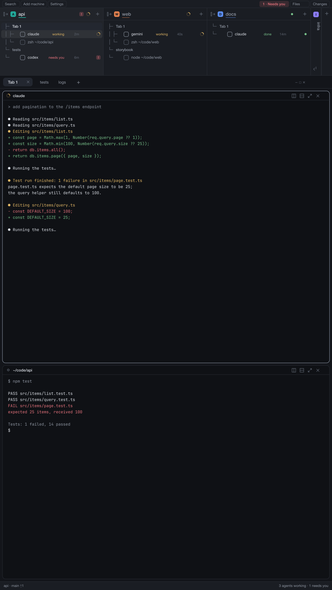
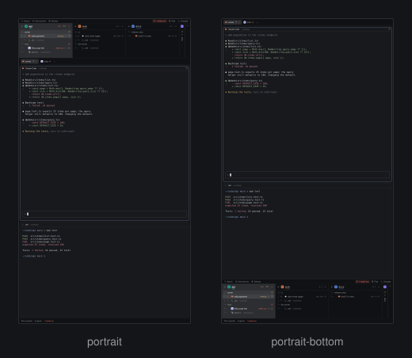
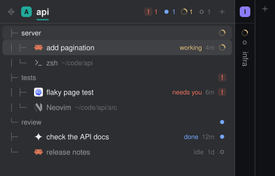
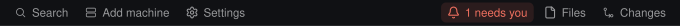
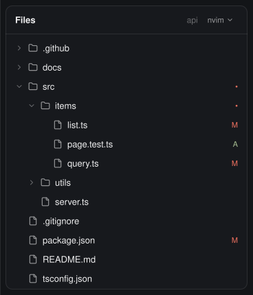

# Portrait layout for Herdr

<a href="https://miguelalexanderdiaz.github.io/herdr-portrait-layout/"></a>

A [Herdr](https://herdr.dev) layout for tall, vertical monitors. Your spaces sit side by side as columns on top, with every agent and its state, and the work area gets the rest of the screen.



*A drawing made from the layout's own parts, with made-up content. Every picture is redrawn by `node scripts/make-preview.mjs`.* Docs: the [documentation site](https://miguelalexanderdiaz.github.io/herdr-portrait-layout/) (from `docs/`); for agents, [AGENTS.md](AGENTS.md) and [llms.txt](llms.txt); Herdr's build brief, [RECIPE.md](RECIPE.md).

## What you get

- **Two layouts.** `portrait` has the bar on top; `portrait-bottom` puts it just above the status line. `ctrl-shift-y` flips between them.<br>
- **Space tree** (`portrait-tree`). One column per space with its tabs, panes and every agent, its state and how long it has been in it. Spaces fold into thin strips.<br>
- **Bar strip** (`bar-strip`). The bell lights up as soon as an agent needs you, and one click takes you to it.<br>
- **Side panel** (`portrait-files`, `nvim-float`, `portrait-viewer`). Files shows the focused pane's folder with git marks, and a click opens a file in the editor you pick; pictures and PDFs open in a viewer.<br>
- **Tab bar and pane headers** (`portrait-tabs`, `portrait-pane`), and the *Agents waiting* list (`attention-picker`, `ctrl-shift-j`).

Every part, and what clicking it does: [Usage](https://miguelalexanderdiaz.github.io/herdr-portrait-layout/usage.html).

## Requirements

The Herdr desktop app, 0.1.12 or newer (built and used on 0.1.12). `git` (change marks), an editor such as `nvim` and Poppler (every page of a PDF; `brew install poppler`) are optional. No network, no account.

| Feature | macOS | Linux | Windows |
|---|---|---|---|
| Layouts, tree, tab bar, pane headers, bell, waiting list | Works | Not run, expected to work | Not run, expected to work |
| Files listing and git marks | Works | Not run, expected to work | Not run, expected to work (PowerShell listing) |
| Click a file to edit it (terminal editors) | Works | Not run, expected to work | No: the default app or the read-only preview |
| Pictures and PDFs in the viewer | Works | Not run, expected to work | Not run, expected to work |
| Keys | `cmd-` and `ctrl-shift-` | `ctrl-shift-` | `ctrl-shift-` |

Developed and used on macOS only. Linux and Windows are described from the code, not from a test run; no CI run has been reported yet. The layouts keep the system title bar, so no window buttons are drawn on Linux and Windows. Details, and the code that decides each row: [Platforms](https://miguelalexanderdiaz.github.io/herdr-portrait-layout/platforms.html).

## Install

macOS and Linux:

```sh
curl -fsSL https://raw.githubusercontent.com/miguelalexanderdiaz/herdr-portrait-layout/main/install/install.sh | sh
```

Windows (PowerShell):

```powershell
irm https://raw.githubusercontent.com/miguelalexanderdiaz/herdr-portrait-layout/main/install/install.ps1 | iex
```

It shows what the mods reach and asks before writing anything. It backs up whatever it replaces, merges your
`keys.json`, checks each mod with `herdr-app check` and, the first time, switches to the `portrait` layout.
Running it again updates.

Remove it with the same command and the uninstall flag:

```sh
curl -fsSL https://raw.githubusercontent.com/miguelalexanderdiaz/herdr-portrait-layout/main/install/install.sh | sh -s -- --uninstall
```

```powershell
$env:HERDR_UNINSTALL = 1; irm https://raw.githubusercontent.com/miguelalexanderdiaz/herdr-portrait-layout/main/install/install.ps1 | iex
```

With an agent, by hand, options and checks: [Install](https://miguelalexanderdiaz.github.io/herdr-portrait-layout/install.html).

## Keys

| Section | Key | Action | What it does |
|---|---|---|---|
| `layout:portrait` | `ctrl-shift-g` | `layout.toggle:bar` | Show or hide the bar (strip and space tree) |
| `layout:portrait` | `cmd-b` | `layout.toggle:bar` | macOS alias of the bar toggle (Herdr's macOS default for the sidebar toggle, which these layouts have no node for) |
| `layout:portrait` | `ctrl-shift-y` | `layout.switch:portrait-bottom` | Switch to portrait-bottom |
| `layout:portrait` | `ctrl-shift-j` | `mod.open:attention-picker` | Open or close the Agents waiting list, with its search box |
| `layout:portrait-bottom` | `ctrl-shift-g` | `layout.toggle:bar` | Show or hide the bar (strip and space tree) |
| `layout:portrait-bottom` | `cmd-b` | `layout.toggle:bar` | macOS alias of the bar toggle (Herdr's macOS default for the sidebar toggle, which these layouts have no node for) |
| `layout:portrait-bottom` | `ctrl-shift-y` | `layout.switch:portrait` | Switch to the portrait layout |
| `layout:portrait-bottom` | `ctrl-shift-j` | `mod.open:attention-picker` | Open or close the Agents waiting list, with its search box |

`cmd-b` is macOS only; on Linux and Windows `cmd` is the Super or Windows key, which the system usually keeps, so expect it to do nothing there (untested) and use `ctrl-shift-g`. If you rename a layout, rename its `layout:<name>` section and the `layout.switch:` values with it. The bell's tooltip prints the key really bound on your machine. `ctrl-b` chords are not shipped (they take `ctrl-b` from your terminals); the optional set is on the [Configuration page](https://miguelalexanderdiaz.github.io/herdr-portrait-layout/configuration.html#tmux) and in [AGENTS.md](AGENTS.md).

## Theme

No theme is pinned: Settings decides, and every Herdr theme names the same colours, so any theme works. Chrome, text and state colours come from the theme (`foreground`, `background`, `muted`, `dim`, `chrome`, `raised`, `hover`, `selected`, `border`, `accent`, `working`, `blocked`, `done`, `idle`; Files also uses `ansi1` to `ansi6`). The exceptions are the space marks, six fixed colours that look the same on every theme, with a white or near-black letter chosen per colour by contrast. The mark colour is also the title rule and the active folded space's name; on a light theme that name is mixed toward the text colour for contrast (how it looks on `paper` has not been seen). To fix a theme in the layout, add `"theme": { "light": "paper", "dark": "graphite" }` to the layout's root, or carry your own `themes/<name>.json`.

## Privacy

Nothing here uses the network (`rg -n "fetch|XMLHttpRequest|WebSocket" mods` prints nothing). What each mod reads, runs and writes:

- `bar-strip` reads agents, the layout tree and your key bindings. It runs nothing and stores nothing.
- `portrait-tree` reads spaces, machines, tabs, panes and agents. It stores which spaces are folded, and when each agent's state last changed (an agent that is gone loses its entry after 7 days). It writes one small SVG per space name under `data/portrait-tree-spines/` in the Herdr home folder.
- `portrait-tabs` stores which side panel each space last had open. `portrait-pane` reads its own pane and stores nothing.
- `portrait-files` lists the focused pane's folder (500 entries per folder, 5,000 in all), runs `sh` or `powershell`, `git status` and your login shell once for its PATH, checks which editors are installed (`command -v`, and on macOS the apps folders), and starts the editor you picked or hands a file to the system's app (never a program); nothing runs while the panel is closed. It reads one file's text when you alt-click it or pick the preview. nvim sockets go to `/tmp`; an editor's terminal carries labels with the full file path, which `hc ls` shows. It stores your editor choice in the shared key `files.editor`.
- `nvim-float` runs `nvim --remote` commands against an nvim this layout started, only from its close button or Keep menu.
- `portrait-viewer` reads the picture or PDF you click (inside your home folder), copies it or draws its pages with Poppler (`pdftoppm`) under `data/portrait-viewer/cache/` in the Herdr home folder (deleted after 30 days, at most 200 MB), and opens it in Preview or the default app when you ask.
- `attention-picker` (bundled) reads the screen text of blocked or finished agents with `hc read` (60 lines each, every 3 seconds, only while the list is open) and keeps one question or message line per agent. It remembers when it first saw each agent's state in local storage (`attention.seen`: agent address, state group, time; no screen text). It writes the shared key `attention.sort`.

The full table with the function that does each thing: [Privacy](https://miguelalexanderdiaz.github.io/herdr-portrait-layout/privacy.html).

## Troubleshooting

- **Layout won't load.** Read `layout.error` in the Herdr home folder; `ctrl-alt-shift-escape` always returns to the default layout.
- **The waiting-list key does nothing.** Check `keys.error`, that the key is in the section of the shown layout, and that the mod is named `attention-picker`.
- **A click opens the wrong thing or "Couldn't open nvim".** Pick the editor with the `▾` in the Files header; it lists only what is on your login shell's PATH (and on macOS in the apps folders). "Couldn't open" means `hc run` failed or the terminal did not appear within 10 seconds.
- **A PDF shows only its first page.** Install Poppler (`brew install poppler`, `apt install poppler-utils`, `scoop install poppler`).
- **Columns cut off.** Each needs 290 px; use the arrow markers, swipe sideways, fold spaces, or widen the bar. A folded space is 34 px wide.

More: [Troubleshooting](https://miguelalexanderdiaz.github.io/herdr-portrait-layout/troubleshooting.html).

## Uninstall

```sh
curl -fsSL https://raw.githubusercontent.com/miguelalexanderdiaz/herdr-portrait-layout/main/install/install.sh | sh -s -- --uninstall
```

Windows, and removing it by hand: [Install](https://miguelalexanderdiaz.github.io/herdr-portrait-layout/install.html).

## What is original, cloned, bundled

`portrait-tree`, `bar-strip`, `nvim-float` and `portrait-viewer` are original. The two layouts and `portrait-tabs`, `portrait-pane`, `portrait-files` are clones of Herdr's shipped 0.1.12 layout and mods (`cloned_from`), changed. `attention-picker` is a bundled copy, kept unchanged and checked file by file against `scripts/bundled.json`. Small icons are carried inside each mod: Lucide icons (ISC; a few also MIT), art copied from Herdr's shipped mods (Apache-2.0), and two drawings made for this layout; [NOTICE](NOTICE) lists every file. What the layout needs from Herdr (its status line, Changes tab, search and menu overlays) is on [How it works](https://miguelalexanderdiaz.github.io/herdr-portrait-layout/how-it-works.html).

[CONTRIBUTING.md](CONTRIBUTING.md), [CHANGELOG.md](CHANGELOG.md). Apache-2.0, see [LICENSE](LICENSE) and [NOTICE](NOTICE).
