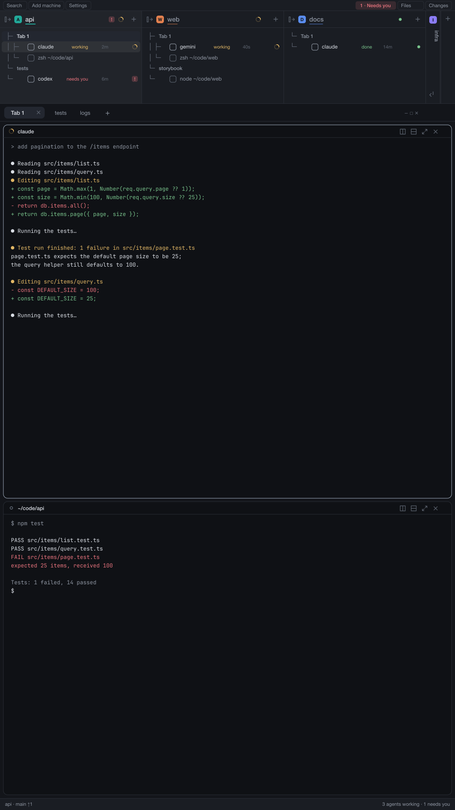

# Portrait

A layout for vertical monitors. A full-width bar across the top holds one column per space, each a small tree of
its tabs and panes with every agent's status; the tab strip and the panes fill the rest of the window; Files and
Changes open in a panel on the right. A second layout, Portrait bottom, puts the same bar at the bottom.



This file is the brief: enough to build Portrait from an empty folder. The files next to it are one build of it. If
they don't work on your Herdr, or you want it different, build it again from here. The picture is drawn from invented
content (`scripts/make-preview.mjs`); it is not a screenshot of anyone's window.

Made for Herdr 0.1.12. It uses the theme, fonts and keys of the person's own settings: it sets none.

## What you see

Top to bottom, the whole window width. The window keeps the system title bar; on Linux and Windows the tab strip
also draws the minimize, maximize and close buttons.

1. **The bar**, 246px tall (the drag handle under it resizes it: 90px to 1400px), background `chrome`, a 1px `border`
   rule under it.
   - **The strip**, 26px, `chrome`, text 11.5px. On the left three outlined buttons with a 13px icon: *Search*,
     *Add machine*, *Settings* (a 6px `accent` dot appears on Settings while an app update is downloaded). On the right
     the *bell* chip, then the panel buttons *Files* and *Changes*.
     The bell reads "Needs you" when no agent waits, "1 needs you" and/or "2 done" otherwise, in `blocked` (asking)
     or `done` (finished) with a 12% tint of the same color behind it. A panel button is lit (`selected`
     background, `foreground` text) while its tab is open in the right panel.
   - **The space columns**, the rest of the bar's height. One column per space, side by side, each at least 290px
     wide and sharing the width equally, with a 1px `border` rule between them; the active space's column is
     `raised`. A folded space is a 34px strip. After the last column a 34px strip with a `+` makes a new space.
     - The **header**, 40px: a fold button, an 18px badge (radius 5) with the space's first letter on the space's
       color (white or near-black, whichever contrasts), the name at 15px semibold (`foreground` if active,
       otherwise `muted`) with a 2px rule under it in the space's color exactly as wide as the name (softened
       while another space is active), the machine's name with a server icon when the space lives on another
       machine, the state counts (`! 1  ⟳ 2`), and a `+`.
     - Under the header, per tab a 24px **tab row** (tree line `├─` or `└─` in `dim` monospace 12px, the tab's name
       or "Tab N" at 12px medium, a 14px glyph when an agent in it is not idle) and per pane a 26px **pane row**:
       the tree lines, the program's 15px icon, the name at 12.5px, then for agents the state word ("needs you",
       "done", "working", "idle"; dropped when the column is narrower than 320px), the time since the state last
       changed ("<1m", "5m", "3h", "2d") and a 14px state glyph. A plain terminal or mod pane shows its program
       or mod name and its folder (path shortened with `~`, losing its start when short of room). The focused
       pane's row is `selected`, the shown tab's row `hover`.
     - A **folded space** is a 34px strip: its badge on the header line, one 14px glyph per agent (six at most, then
       `+N`), and its name running down the strip like a book spine, in the space's color when active and `muted`
       otherwise.
     - When the columns don't fit, a whole run of columns is shown, with 28px `‹` and `›` markers at the ends that say
       how many spaces are off that side and the most urgent state among them, and a 5px track under the columns
       whose thumb shows where the run sits.
2. **The work area**, between the bar and the status line, background `canvas`.
   - **The tab strip**, 42px, `chrome`, 1px `border` rule below, draggable (moves the window, double-click maximizes).
     Tabs are pills 29px high (radius 7, 1px border, 12.8px text) of the active space only; the active one has the
     `raised` background, a `border` outline, `foreground` text and a close icon; the others are `muted` on
     `chrome`. A tab shows the program's icon (14px), its name (170px at most; "Name Z" when zoomed) and, when an
     agent in it works, a 12px spinner in `working`, or when it is blocked or done a 6px dot in `blocked` or `done`.
     At the end a 26px `+` and, on Linux and Windows, the three window buttons.
   - **The panes**, in a 8px padding with 8px between cards: the active tab's terminals. Each pane is a card with
     radius 10, a 1px `border` outline (1px `accent` when focused), background `background`, and a 30px header
     that is always shown. Terminals have 14px top and bottom, 12px left and right padding inside the card; one
     pane alone is also framed.
   - **The pane header**, 30px, `background`, 1px `border` rule below, text 12px: the program's icon (14px), the
     agent's name, or the terminal's title, in `foreground` medium (260px at most), then the folder in `dim` (with
     `~`), then the status: a 12px spinner when working, a "Needs you" chip (18px high, radius 5, `blocked` text
     on a 15% `blocked` tint, 10.5px semibold) when blocked, a 7px `done` dot when done.
3. **The status line**, 28px, the shipped `workspace-status` mod.
4. **The right panel** (hidden at first), 368px wide (280px to 1600px, resizable) to the right of everything, 8px
   padding, holding one of: **Files** (a card, radius 10, 1px `border`, `background`: a 42px header "Files" with the
   folder's name on the right, then the folder tree) or **Changes** (the shipped `changes` mod).

**Portrait bottom** is the same layout with the bar moved: the work area first, then the bar, then the status line. Nothing
else differs.

Colors are all theme names (`canvas`, `chrome`, `raised`, `background`, `border`, `accent`, `foreground`, `muted`,
`dim`, `hover`, `selected`, `working`, `blocked`, `done`, `idle`), so any light or dark theme works. The only fixed colors
are the space marks (`#22a99a`, `#e3814f`, `#5b8def`, `#8b7cf6`, `#3fae6a`, `#d9649a`, used for the shared
`space.colors` names `ansi6`, `ansi3`, `ansi4`, `ansi5`, `ansi2`, `ansi1`) and the badge ink (`#ffffff` or `#141414`).
Text is the person's UI font; the tree lines use JetBrains Mono and the folded names Geist, both shipped with Herdr.

## How it behaves

| Agent status | Tree row | Tab | Pane header |
| --- | --- | --- | --- |
| working | 12px spinner in `working`, turning once in 0.9s; word "working" | 12px spinner | 12px spinner |
| blocked (needs you) | 14px chip, `!` in `blocked` on a 15% tint; word "needs you" | 6px `blocked` dot | "Needs you" chip |
| done | 7px `done` dot; word "done" | 6px `done` dot | 7px `done` dot |
| idle | 7px ring in `idle`; word "idle"; the name is `muted` unless focused | nothing | nothing |

The time next to a state is how long ago the agent last changed between working, blocked and idle (done counts as
idle); it is kept per agent and published to other mods as the shared `agents.since`. The tree redraws every 30s so
the times move.

**The bar's strip**
- *Search* opens the shipped `picker`; *Add machine* the shipped `machine-add`; *Settings* runs `app.settings`.
- The *bell*: a click goes to the agent that has waited longest, asking agents before finished ones, with
  `agent.focus`; clicking again moves to the next, wrapping. Shift-click, or the key for `bar-strip.attention`
  (ctrl-shift-j), opens the "Agents waiting" list (`attention-picker`) with a search box. Its tooltip names the
  real key. Idle bell: dimmed, nothing happens on a plain click.
- *Files* and *Changes* open the right panel on that tab (`layout.select` on `panel-body`, then `layout.show` on
  `panel`); clicking the lit one hides the panel (`layout.hide`). The panel choice is remembered **per space**: switch
  spaces and the panel comes back as that space had it, or closed if it never had one.
- *Vault* (only when the optional Vault panel is installed, see Built from) is a third panel button.

**The space columns**
- Click a header: select the space. Drag a header onto another: reorder (`space.move`, within one machine). Right-click
  a header, tab row or pane row: the shipped `menu` for it. The fold button (or a click on a strip) folds a column into
  a strip and back; hovering a strip swaps its badge for an unfold icon.
- Click a tab row: show that tab (selecting its space first). Double-click: rename. Drag onto another tab of the same
  space: reorder (`tab.move`).
- Click an agent or pane row: `pane.focus`.
- The `+` in a header opens the shipped `new-menu` for that space (a terminal or an agent, new space, worktrees); the `+`
  strip at the end runs `space.new`.
- A folded space opens when one of its agents gets focus (by the bell, the waiting list, a notification or
  `agent.next`), and folds again once you move to another space. Opening or folding one by hand keeps it as you left it.
  Folding the space you are in keeps it folded.
- `agent.next` and `agent.prev` follow the tree, folded spaces left out (`setAgentOrder`).
- The wheel: a horizontal swipe, or Shift plus the wheel, moves the run of columns by one per 40px; plain vertical
  scrolling stays with the column. The markers do the same on click. The run follows the active space.
- A pane that belongs to the optional Vault reader (see Built from) shows the note's name and its folder in the
  vault instead of a program and a folder, in the tree and in the pane header.

**The tab strip**
- Click a tab: select. Double-click: rename. Drag onto another: reorder. Right-click: the shipped `menu`. The active
  tab's `x`: `tab.close`. `+`: the shipped `new-menu`. The wheel over the strip: previous or next tab.
- The window buttons (Linux and Windows) run `window.minimize`, `window.maximize` and `window.close`; Windows uses
  vector icons (with a restore icon when maximized), Linux plain glyphs.

**The pane header**
- Click: focus the pane. Hover: four 14px buttons appear: split right, split down, zoom (unzoom while zoomed), close
  (`pane.split`, `pane.zoom`, `pane.close`).

**The Files panel**
- Shows the focused pane's folder (on its machine when the space lives on another), loaded lazily: a folder's contents
  load when it is opened. Rows are 28px with a chevron, folder or file icon and the name; git changes show a letter
  mark. Limits: 500 entries per folder, 5,000 in all; previews stop at 400,000 characters.
- Click a folder: expand or collapse. Click a file: open it in **nvim** in a floating window over the app (see
  Watch out for where it works). Alt-click: a read-only, syntax-highlighted preview in the panel, with a back arrow.
- The floating window's title bar shows the program's icon, the file's name and its folder and has two buttons:
  *Keep*, a menu with "New tab" (the nvim becomes a tab of the space, `terminal.keep`) and, for every nvim tab already
  kept in the space, "Add to <tab>" (the file opens there as a buffer, that tab is focused and the float quits); and
  `x`, which quits the float's nvim (`:confirm qa`, so unsaved changes ask first). The window closes when nvim ends.
- The nvims started here are labeled with their file, which the tree shows as the pane's name.

**What moves:** the tree and the strip follow focus and status live; the panel, the folded set and each agent's time
are remembered across restarts (the mods' own `localStorage`).

### Keys

`keys.json` has two identical sections, `layout:portrait` and `layout:portrait-bottom` (a key works only while that
layout shows):

| Key | Action | What it does |
| --- | --- | --- |
| `ctrl-shift-g` | `layout.toggle:bar` | show or hide the bar |
| `cmd-b` | `layout.toggle:bar` | the same, macOS alias (it replaces Herdr's macOS sidebar toggle, which these layouts have no sidebar for) |
| `ctrl-shift-y` | `layout.switch:portrait-bottom` (in Portrait), `layout.switch:portrait` (in Portrait bottom) | flip the bar to the other edge |
| `ctrl-shift-j` | `bar-strip.attention` | the Agents waiting list |

None of these is a Herdr default, a plain `ctrl` letter (programs in terminals use those), or `ctrl-alt` (AltGr on
Windows). Rename the sections if you rename the layout files.

## Built from

**The layouts** (`layouts/portrait.json`, `layouts/portrait-bottom.json`, each with a small drawn thumbnail,
`layouts/portrait.svg` and `layouts/portrait-bottom.svg`, named by the root `preview` field). Both are clones of Herdr's
`main` 0.1.12 (`cloned_from`). Root: a `row` with `background: "canvas"`, `terminal_padding: [14, 12]`, a 1px `border`
divider, and no theme, colors or fonts (the person's settings apply). Node tree (ids are used by the mods):

```
root (row)
├─ left (column, divider 1px border, resizable)
│  ├─ bar (column, 246px high, min 90, max 1400, background chrome)
│  │  ├─ bar-strip (block, 26px)  mod bar-strip
│  │  └─ tree (block)             mod portrait-tree
│  ├─ work (column, not resizable)
│  │  ├─ tabs (block, 42px, window_drag)  mod portrait-tabs
│  │  └─ work-body (row, padding 8, gap 8)
│  │     └─ main (block)  content { tab: "active", pane: { header: { content: { mod: "portrait-pane" },
│  │                       reveal: "always", height: 30, position: "top" }, background: "background",
│  │                       border: { width: 1, color: "border" }, focus: { width: 1, color: "accent" },
│  │                       radius: 10, gap: 8, lone: true } }
│  └─ status (block, 28px)  mod workspace-status (shipped)
└─ panel (column, 368px, min 280, max 1600, hidden, padding 8)
   └─ panel-body (stack, active "files")
      ├─ files (block)    mod portrait-files
      └─ changes (block)  mod changes (shipped)
```

Portrait bottom lists `left`'s children as `work`, `bar`, `status`; every other node is the same, and `validate.mjs`
fails if the two files drift apart.

**Optional: Vault.** If the optional mods `vault` and `vault-reader` (the herdr-obsidian-vault repo) are installed, add
`snippets/vault-panel.json` (`{ "id": "vault", "type": "block", "content": { "mod": "vault" } }`) as the last child of
`panel-body` in the layout file. The strip then shows a *Vault* button (icon `book-open` from the vault mod). The
Vault button, its remembered panel and the note rows appear only when the mod is installed **and** the layout has
the `vault` node; without both, nothing about the Vault is drawn and nothing is loaded.

**The mods** (every folder in `mods/`; all have `place: "none"`: the layout or another mod puts them where they show):

| Mod | Role | `props` / commands it reads |
| --- | --- | --- |
| `portrait-tree` | the space columns, the tab and pane rows, the folded spines; publishes `agents.since`; sets the agent order | none; uses `spaces()`, `agents()`, `panes()`, `terminals()` |
| `bar-strip` | the 26px strip, the bell and the panel buttons | commands `attention` (the list) and `jump` (what a bell click does) through `nextCommand()`; opens `attention-picker` with props `{ search }` |
| `portrait-tabs` | the tab pills, window buttons, per-space panel memory (clone of the shipped `tabs` 0.1.12) | none |
| `portrait-pane` | the pane header (clone of the shipped `pane` 0.1.12) | `props()` = `{ pane, terminal }` from the app |
| `portrait-files` | the Files panel with the nvim launcher and the read-only preview (clone of the shipped `files` 0.1.12) | none |
| `nvim-float` | the floating nvim's title bar and its Keep menu; opened only through `openOverlay` | `props()` = `{ terminal, socket, file, space, on, overlay }` or `{ menu: true, window, ... }` |
| `attention-picker` | the Agents waiting dialog (640px wide); a bundled copy of the herdr-agents-waiting repo's mod, do not edit | `props()` = `{ search }`; reads shared `agents.since`, `attention.sort`, `space.colors` |

**Shipped mods it needs** (Herdr 0.1.12 or newer; they are replaced whole on every Herdr start, never edited here):
`workspace-status` (the status block), `changes` (the panel child), and opened by name as overlays `picker`,
`machine-add`, `menu`, `new-menu`. No other shipped file is read: the icons are copied into the mods that use them (see
`NOTICE`).

**Shared state:** writes `agents.since` (agent address to the time of its last state change); reads `workspace.panels`
(which panel tabs the person has enabled, default `["files", "changes"]`), `space.colors` (space id to a color name or
`#rrggbb`), `vault.panes` (pane id to `{ vault, file, id }`, only for Vault note rows) and the vault mod's presence.

**Functions and commands used:** `spaces, agents, panes, terminals, focused, run, shared, setShared, setAgentOrder,
theme, settings, layout, updates, window, home, appHome, props, nextCommand, openOverlay, closeOverlay, notify,
exec, hc, readTextFile, watchFolder`; commands `agent.focus`, `layout.show`, `layout.hide`, `layout.select`,
`layout.toggle`, `layout.switch`, `mod.open`, `app.settings`, `space.select`, `space.move`, `space.new`, `tab.select`,
`tab.move`, `tab.rename`, `tab.close`, `pane.focus`, `pane.split`, `pane.zoom`, `pane.close`, `terminal.keep`,
`window.minimize`, `window.maximize`, `window.close`.

**What it reaches outside itself (read this before installing):**
- **Network:** none. No mod calls `fetch` or opens a socket to another host.
- **Runs programs:** `git` (`rev-parse`, `status`, read-only, for the Files marks); `sh` (lists a folder and launches
  nvim on macOS and Linux and on remote POSIX machines); `powershell` (lists a folder on Windows); `nvim` (the Files
  click); `hc` (`hc run` to start the nvim terminal, `hc read` in `attention-picker` to read the last lines of a
  blocked or finished agent's terminal every 2 seconds while its list is open).
- **Reads outside its folder:** the folders shown in the Files panel and the file you click (through `exec` and
  `readTextFile`, on the folder's own machine); terminal text through `hc read`; the shared values above; the
  app's own list of spaces, tabs, panes, terminals and agents (names, folders, titles).
- **Writes outside its folder:** one small SVG per space name under `<app home>/data/portrait-tree-spines/` (the
  rotated name of a folded space; the folder is not inside the mod because Herdr reloads a mod when its files
  change); a unix socket `/tmp/herdr-nvim-<id>.sock` per nvim started from the panel (macOS and Linux); the mods'
  `localStorage` (folded spaces, remembered panels, state times). Nothing is written into the person's projects:
  the nvims write only what the person saves.

**Art:** icons are small SVGs inside the mod that uses them (provenance and licenses in `NOTICE`); the preview and thumbnails
are drawn by `scripts/make-preview.mjs`.

## Watch out

- **The bar is 246px high, not wide.** `size.px` on a child of a column is its height. Making the bar a left column
  turns this into another layout. Three open columns need 3 × 290px plus the 34px `+` strip; a 1080px-wide window just
  fits three open columns and one strip, and anything more brings the `‹ ›` markers.
- **No theme, no fonts.** The preview uses colors close to Herdr's `graphite`; on `paper` or a theme from `themes/` the
  same layout takes that theme's colors. Do not pin a theme in the layout: Settings decides.
- **The Vault is opt-in** (see Built from). A build that always draws the Vault button without the mod installed shows
  a button that opens a panel for a missing mod.
- **Editing in nvim works on macOS and Linux and on remote POSIX machines; on Windows a click opens the read-only preview**
  (with a one-time notice that nvim editing is not available there). nvim must be installed on the machine of the
  folder; it is started through `sh` with the PATH of the person's login shell, so Homebrew and similar installs work,
  and a missing nvim shows a toast "Couldn't open nvim" rather than doing nothing. The socket stays under `/tmp`
  because macOS temp folders can exceed the 104-byte limit of a unix socket path.
- **Keys:** `cmd-b` is macOS only. Elsewhere use `ctrl-shift-g`. The chords are `ctrl-shift` letters because no
  plain `ctrl` letter is free (programs use them) and `ctrl-alt` is AltGr on Windows. A terminal program that wants
  `ctrl-shift-g`, `-y` or `-j` loses them while one of the two layouts shows; rebind in `keys.json`. Chords with a
  prefix such as `ctrl-b a` make every plain `ctrl-b` a prefix in every terminal (tmux, readline); this repo ships none.
- **Layout and section names are load-bearing.** If an installer renames a layout because the name is taken, rename the
  `layout:<name>` sections in `keys.json` and the `layout.switch:<name>` actions with it. If you already have a
  mod named `attention-picker` (the herdr-agents-waiting repo), keep yours: `bar-strip` opens it by that name.
- **The per-space right panel is the mods' own memory, not Herdr's.** It lives in `portrait-tabs`' `localStorage` and is
  applied when the active space changes, so the tab strip (`tabs`) must be present for it to work; the panel buttons
  themselves are in `bar-strip`.
- **A folded space's name is an SVG written at run time.** It is generated under `<app home>/data/`; if that folder is not
  writable the strip shows the badge and glyphs but no name.
- **Limits:** at most 500 entries per folder and 5,000 rows in the Files panel; previews of 400,000 characters;
  six glyphs per folded strip; 170px tab names; 260px pane names.
- **Pane-less agents:** the tree builds its rows from panes. Should Herdr ever list an agent that has no pane, it has no
  row, though it still counts in the bell and in its space's counts.

### Load-bearing names

Other pieces look these up by name. A build or a rename that drops one breaks something silently.

- **Layout ids:** `root`, `left`, `bar`, `bar-strip`, `tree`, `work`, `tabs`, `work-body`, `main`, `status`, `panel`, `panel-body`, `files`, `changes`
- **Mods:** `portrait-tree`, `bar-strip`, `portrait-tabs`, `portrait-pane`, `portrait-files`, `nvim-float`, `attention-picker`, `workspace-status`, `changes`, `picker`, `machine-add`, `menu`, `new-menu`
- **Key sections:** `layout:portrait`, `layout:portrait-bottom`
- **Shared keys:** `agents.since`, `workspace.panels`, `space.colors`
- **Commands:** `bar-strip.attention`, `layout.toggle`, `layout.switch`, `layout.select`, `layout.show`, `layout.hide`, `agent.focus`

## Done when

- [ ] `herdr-app check <app home>/mods/<mod>` passes for each of the seven mod folders, and `herdr-app commands` lists every
  command in `keys.json`.
- [ ] With the layout `portrait` shown and no Vault mods installed: the window is, top to bottom, a 246px bar (26px strip with
  Search, Add machine, Settings, the bell, Files, Changes; then the space columns), a 42px tab strip, the pane cards, and a 28px
  status line; there is no Vault button and no Vault panel.
- [ ] With three spaces, each is a column of at least 290px with its badge, name and rule; a fourth makes `‹`/`›` markers and a
  track appear (in a 1080px window); a folded space is a 34px strip with its name written down it.
- [ ] A working agent shows a spinning 12px ring in its tree row, its tab and its pane header; a blocked one shows the `!` chip in the
  tree, a 6px dot on the tab and the "Needs you" chip in the header, and the bell says "1 needs you"; clicking the bell focuses
  that agent and opens its folded space if it was folded.
- [ ] Pressing `ctrl-shift-y` switches to `portrait-bottom` and back; `ctrl-shift-g` hides and shows the bar; `ctrl-shift-j` (or a
  shift-click on the bell) opens the Agents waiting list with a search box.
- [ ] The Files button opens a 368px panel with the focused folder's tree; closing it and switching space restores that space's
  choice. On macOS or Linux with nvim installed a click on a file opens it in a floating window whose Keep menu offers "New tab".
  On Windows the click shows a read-only preview.
- [ ] Idle, no mod writes anything but `<app home>/data/portrait-tree-spines/*.svg`, the nvim sockets and its own
  `localStorage`; no mod reaches the network; `git status` of the person's projects is unchanged after browsing them.
- [ ] After adding `snippets/vault-panel.json` with the vault mods installed, the strip shows a *Vault* button that opens that panel.
